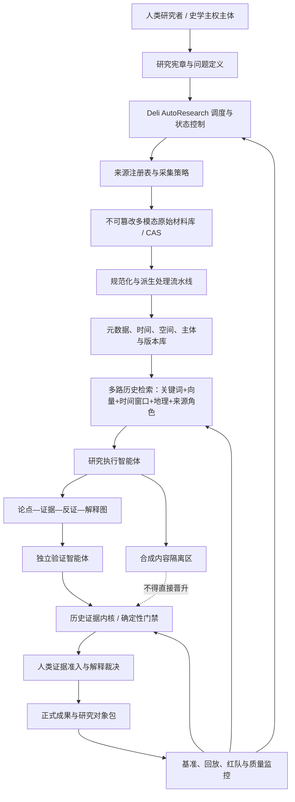

# 闽南计算生成式文史：人工智能史学与工程体系落地方案 v1.0

> 日期：2026年8月29日  
> 文档性质：工程总纲、审计基线、后续施工输入文件  
> 适用对象：项目发起人、历史研究者、数据工程师、Agent 工程师、知识工程师、红队审计 AI  
> 状态：方案级，不等于已经实现；数学表达均为工程控制模型，不是对历史真理的自动计算

---

## 〇、执行摘要

### 0.1 最终定义

**闽南计算生成式文史**，是：

> **以历史实践辩证唯物主义为最低方法论尺度，以马克思主义的人类解放、中国历史总体和共同体长期生长为最高价值尺度，以闽南文化从自然地理—地域实践中发生、存在、异化并最终死亡的总体过程为研究对象，以人类研究者的史学主权为根本边界，以多模态数据库、自动研究框架、技能库、垂类历史智能体、证据宪法和严格验证系统为物质基础的综合历史哲学及其工程实现。**

它不是普通意义上的“地方大模型”、数字人文展示项目、闽南文化百科、文旅数据库或自动写作系统。它同时具有三重身份：

1. **历史哲学**：解释一种区域文化如何由自然地理、物质生产和长期实践生成，又如何走向死亡；
2. **历史研究哲学**：重新规定问题、证据、解释、价值与主体之间的关系；
3. **历史基础设施哲学**：把上述原则写入数据库、工作流、智能体、验证门禁和发布制度，使历史哲学获得可运行、可审计、可传承的工程形态。

### 0.2 核心目标

本工程不试图复活已经死亡或正在死亡的闽南文化，也不以人工智能模拟“活态传承”。它要保存的是：

- 原始历史证据；
- 自然地理—生产实践—社会结构—共同体心性之间的发生链；
- 历史经验与内生价值的形成机制；
- 对区域历史作出辩证理解和最终评价的历史理性；
- 人类研究者的议题设定权、证据最终准入权、价值判断权与最终解释权。

### 0.3 最高史学宪法

> **人工智能可以自动化史学劳动，但不得取得史学主权。**

AI 可以发现、抽取、整理、比较、提出假设、寻找反证、生成中间文本和执行审计；但不得最终决定：

1. 研究什么；
2. 什么材料可以进入正式证据层；
3. 哪些价值判断成立；
4. 哪一种解释成为正式历史结论。

### 0.4 第一阶段工程结论

本项目不应先训练模型，也不应先追求“闽南历史问答”。第一建设顺序必须是：


a. 明确研究对象与历史哲学；  
b. 建立证据宪法和材料准入制度；  
c. 建立不可篡改的多模态原始材料层；  
d. 建立可追溯的派生、检索、向量与论证层；  
e. 建立垂类历史智能体和验证流程；  
f. 最后才开放生成、研究协作和公共输出。

---

## 一、理论与工程依据

### 1.1 闽南文史的收缩—升华结构

本项目的元叙事不是平面式“文化保护”，而是由物质总体向精神总体收缩、并最终升华为历史哲学：

\[
\text{自然地理}
\rightarrow
\text{地域物质实践}
\rightarrow
\text{社会结构与共同体心性}
\rightarrow
\text{闽南文化}
\rightarrow
\text{闽南文史}
\rightarrow
\text{闽南历史哲学}
\rightarrow
\text{历史哲学的工程化存在}
\]

闽南文化是第一序存在；闽南文史是第二序反思。闽南文化失去现实生命以后，闽南文史成为其对自身发生、矛盾、价值和死亡所作的最高精神总结。

### 1.2 对人工智能史学的五重观察

玛妮·休斯-沃灵顿在《Artificial Historians》与《History and Artificial Intelligence》中，分别从人工历史、历史推理和人工智能伦理等角度讨论算法如何选择、排序、保存和生成历史。其后一本书明确提出三重视角：

1. 人类书写关于 AI 的历史；
2. 人类使用 AI 制造历史；
3. AI 制造历史。

“闽南计算生成式文史”在此基础上增加两个层次：

4. **历史被制造成人工智能**：历史材料被转化为数据、Token、多模态特征、向量和模型参数；
5. **AI 制造的历史重新进入未来数据环境**：机器生成文本被传播、改写、再索引、再训练，成为下一代人工智能理解历史的材料。

完整链条为：

\[
\text{历史实践}
\rightarrow
\text{历史材料}
\rightarrow
\text{机器表征}
\rightarrow
\text{AI生成历史}
\rightarrow
\text{公共认知}
\rightarrow
\text{未来训练材料}
\]

### 1.3 历史不能整体形式化，但成立条件可以形式化

历史与法律不同。特定法律推理可以在封闭事实、规则、优先级和输出状态下进行形式计算；历史研究的材料残缺、概念漂移、问题依赖和多重解释决定了它不能被压缩为自动产生唯一历史真理的形式系统。

本项目只形式化：

- 来源身份与材料谱系；
- 时间、地点、主体和版本关系；
- 论点与证据的支持、反驳、缺失和冲突；
- 解释竞争与不确定状态；
- 研究工作流、人工门禁和审计记录；
- 正式结论成立所需的最低证据条件。

不形式化或不交给机器最终决定：

- 问题为何重要；
- 哪种矛盾是总体性的；
- 历史行为如何作最终价值评价；
- 多个可成立解释中哪一个构成总体叙事；
- 这段历史对人类意味着什么。

因此，工程内核不是“历史真理计算器”，而是：

> **历史证据、论证条件、解释边界与人类主权的治理系统。**

---

## 二、十二条工程宪法

### 第一条：人类史学主权不可让渡

人类研究者永久掌握议题设定、证据最终准入、价值判断和最终解释权。任何工作流不得把人工批准降格为形式点击。

### 第二条：证据先于模型

原始材料必须先保存、核验和登记，模型才可以读取。模型内部知识、训练记忆和流畅表达不得替代外部证据。

### 第三条：来源证明能力必须相对于命题判断

不存在脱离命题的“全局高可信来源”。政府文件可高可信地证明政府在何时如何叙述或采取何种制度行动，但不能当然证明其对古代历史的解释为真。

### 第四条：机器生成内容不得成为历史证据

AI 生成文本、摘要、重写、图像和合成音频不得进入正式原始证据层，也不得因被重复转载而晋升为证据。

### 第五条：向量只负责发现，不负责证成

向量索引是可随时重建的访问层。相似度不是史料，不是相关性的全部，更不是历史命题成立的证明。

### 第六条：检索与解释必须分离

先完成材料发现、来源平衡和人工筛选，再进入解释。不得把 top-k 检索结果直接喂给模型后生成“最终答案”。

### 第七条：整体史优先于局部奇观

任何将局部港口史、单一物象、少数遗存或流量符号提升为闽南文化总体本质的结论，必须触发范围过度门禁。

### 第八条：未数字化不等于不存在

网络查无不得形成否定结论。主位线索、家庭旧照、口述、地方档案和未公开馆藏必须进入“待田野／待档案”状态，而不是被系统删除。

### 第九条：冲突不得静默合并

来源冲突、年代冲突、数字口径冲突和解释冲突必须分别保存。系统不得为获得流畅答案而自动择一。

### 第十条：低频材料不得因统计稀疏被淘汰

时间早期、地方边缘、少数群体、罕见术语和非标准格式材料必须获得专门检索配额和人工检查。

### 第十一条：模型贡献必须成为可检查研究对象

每一次重要 AI 交互必须保存模型版本、提示词、输入来源、工具调用、输出、修订、人工决定与关联证据；AI 既不是作者，也不是不可见工具，而是可审计的研究对象。

### 第十二条：任何正式结论必须能够返回原始材料

正式结论必须能够沿完整谱系返回具体页码、图像区域、音视频时间码、档案号或田野记录。不能返回的结论只能停留在候选层。

---

## 三、总体系统架构



### 3.1 分层定义

1. **历史哲学层**：研究对象、方法论、价值尺度、禁止性原则；
2. **研究宪章层**：具体问题、范围、假设、证据标准、人工门禁；
3. **证据宪法层**：来源角色、准入、冲突、不确定、合成隔离；
4. **多模态材料层**：原始文本、图像、音频、视频、地图、口述和档案；
5. **派生与索引层**：OCR、转写、翻译、结构化、关键词、向量、地理索引；
6. **论证与谱系层**：命题、证据、反证、解释和人类决定；
7. **智能体执行层**：材料发现、抽取、比对、假设、反证、审计；
8. **人类裁决与发布层**：正式准入、价值判断、最终解释、版本发布；
9. **评测与审计层**：基准、回放、失败登记、偏差监测和升级。

---

## 四、研究对象与问题定义系统

### 4.1 研究对象不是“闽南元素集合”

本系统的总体研究对象是：

\[
\text{自然地理}
\rightarrow
\text{生产与生存实践}
\rightarrow
\text{社会组织与权力结构}
\rightarrow
\text{共同体心性}
\rightarrow
\text{历史经验与价值判断}
\rightarrow
\text{文化表征与文史反思}
\rightarrow
\text{异化、衰减与死亡}
\]

单一课题不必覆盖所有环节，但任何总体性结论必须说明其在这条链中的位置以及未覆盖部分。

### 4.2 吸收《Artificial Historians》的六维问题框架

每一个正式研究任务必须填写：

1. **Topics**：研究什么议题；
2. **Times**：时间范围、分期与词汇漂移；
3. **Places and Grounds**：空间、自然条件、地理尺度；
4. **Bodies and Authorities**：实践主体、身体经验、权威和发言位置；
5. **Questions**：问题类型、问题为何由人提出；
6. **Ifs**：反事实、条件命题和未发生可能性。

### 4.3 研究宪章文件

每个项目启动前生成 `research_charter.yaml`：

```yaml
question_id: MCH-Q-0001
human_owner: lau
core_question: "待填写"
why_it_matters: "该问题在闽南总体历史中的位置"
research_object:
  geography: []
  time_range: []
  practice_dimensions: []
question_frame:
  topics: []
  times: []
  places_and_grounds: []
  bodies_and_authorities: []
  questions: []
  ifs: []
value_scales:
  - marxist_human_emancipation
  - china_historical_totality
  - community_long_term_growth
mandatory_source_roles: []
forbidden_shortcuts:
  - popularity_as_truth
  - local_case_as_total_history
  - model_memory_as_evidence
human_gates:
  question_approval: required
  evidence_admission: required
  value_judgment: required
  final_interpretation: required
output_contract:
  decision_brief_max_pages: 3
  evidence_appendix: required
  research_object_package: required
```

### 4.4 全局结论的整体史覆盖门禁

总体性命题至少检查以下维度：

- 自然地理；
- 物质生产；
- 家庭与人口再生产；
- 社会组织；
- 国家—地方关系；
- 阶层、群体与权力；
- 语言、身体和心性；
- 区域与中国历史总体；
- 表征、景观和知识生产；
- 历史转型与死亡机制。

系统不要求机械填满十项，但未覆盖项必须显式列为边界，不得静默泛化。

---

## 五、证据宪法与历史证据内核

### 5.1 两轴来源制度

单一“可信度等级”不足以处理历史材料。正式系统使用两个轴：

#### 轴一：来源生成层级

| 代码 | 类型 | 例示 |
|---|---|---|
| P0 | 原始实物／档案／现场记录 | 原件、原始扫描、录音、照片底片、测绘 |
| P1 | 可靠影印、整理本与官方原始文件 | 影印古籍、档案公布本、法规、原始统计 |
| S1 | 同行评议学术研究 | 专著、论文、学术数据库 |
| S2 | 权威二手整理 | 馆藏目录、工具书、主流媒体调查 |
| N1 | 当代制度／公共叙事材料 | 政府宣传、申遗文本、规划、品牌通稿 |
| C1 | 网络与平台传播材料 | 自媒体、短视频、营销、百科候选 |
| F1 | 主位／田野待验证线索 | 口述线索、家庭旧照、地方记忆 |
| Q0 | 合成或来源不明材料 | AI 生成、洗稿、无可追踪来源 |

#### 轴二：相对于命题的证据角色

| 角色 | 能证明什么 |
|---|---|
| `past_event_evidence` | 过去发生的事件或状态 |
| `institutional_action_evidence` | 当代机构做了什么 |
| `public_narrative_evidence` | 某一时期如何叙述历史 |
| `social_practice_evidence` | 社会实践、语言和生活结构 |
| `statistical_evidence` | 具有明确口径的量化状态 |
| `scholarly_interpretation` | 已有学术解释 |
| `counterevidence` | 对既有命题形成反证或限制 |
| `fieldwork_lead` | 需要田野或档案闭合的线索 |

关键规则：

> 来源等级高，不等于可以证明所有类型命题；证据能力由“来源 × 命题 × 角色”共同决定。

例如，泉州市政府宣传材料可以高可信证明“政府在某年使用了开放包容叙事”，但不能单独证明宋元泉州社会长期和谐。

### 5.2 来源状态机

```text
PROPOSED
  -> ACQUIRED
  -> QUARANTINED
  -> TECHNICALLY_VALIDATED
  -> HUMAN_REVIEWED
  -> ADMITTED / REJECTED / RESTRICTED
  -> DEPRECATED / SUPERSEDED
```

### 5.3 命题状态机

```text
CANDIDATE
  -> SOURCE_LINKED
  -> COUNTEREVIDENCE_SEARCHED
  -> NEEDS_MORE_EVIDENCE / CONFLICTED
  -> HUMAN_ADMITTED / REJECTED
  -> PUBLISHED
  -> REVISED / WITHDRAWN / SUPERSEDED
```

“证据门禁通过”只表示在当前问题、材料和规则下可进入正式论证，不等于永恒真理。

### 5.4 历史证据内核的职责

历史证据内核 `HEK` 只做确定性检查：

- 原始文件哈希是否存在；
- 来源身份、权限和链路是否闭合；
- 引用是否指向具体页、段、图像区域或时间码；
- OCR、转写、翻译是否绑定原始对象；
- 命题时间、空间和主体范围是否超出材料；
- 是否完成反证搜索；
- 是否存在未披露冲突；
- 是否混入 Q0 合成材料；
- 人类准入签名是否存在；
- 发布包是否可回放。

HEK 不判断历史意义，不对价值问题作裁决。

### 5.5 必须实现的门禁

1. `authenticity_gate`：原始对象与来源身份；
2. `provenance_gate`：采集、派生和版本谱系；
3. `source_span_gate`：命题必须绑定证据区间；
4. `claim_role_gate`：材料是否有资格证明该类命题；
5. `temporal_scope_gate`：不允许阶段性事实被无标记地永恒化；
6. `geographic_scope_gate`：局部材料不得无依据推广至全闽南；
7. `whole_history_gate`：总体结论必须披露未覆盖维度；
8. `counterevidence_gate`：争议命题必须完成反证搜索；
9. `synthetic_quarantine_gate`：模型内容不得进入证据层；
10. `human_sovereignty_gate`：四项人类权力必须完整；
11. `citation_gate`：零虚构引文；
12. `publication_gate`：研究对象包、版本和审计报告齐全。

---

## 六、多模态历史数据库

### 6.1 数据层级

\[
\text{原始材料}
>
\text{规范化副本}
>
\text{人工标注与结构化数据}
>
\text{检索索引与向量}
>
\text{AI研究候选}
\]

“>”表示认识论优先级，不表示查询速度。

### 6.2 建议技术栈

为避免过度工程，第一版采用单体可审计栈：

- **运行语言**：Python 3.12；
- **原始对象库**：本地文件系统内容寻址存储，后续可换 MinIO；
- **元数据与论证关系**：PostgreSQL；
- **向量检索**：pgvector；
- **地理信息**：PostGIS；
- **全文检索**：第一阶段 PostgreSQL FTS，规模扩大后再评估 OpenSearch；
- **工作流与调度**：复用 `deli-autoresearch`；
- **API**：FastAPI；
- **CLI**：Typer；
- **内部审查界面**：源图像／音视频与 AI 派生内容并排显示；
- **版本与迁移**：Git + Alembic；
- **分析输出**：JSONL、Parquet、Markdown；
- **大文件**：不得普通 Git 跟踪，只跟踪清单、哈希、审核记录和派生配置。

第一版不引入 Neo4j。命题—证据图先使用 PostgreSQL 的节点表和边表，避免基础设施膨胀。

### 6.3 原始对象目录

```text
MCH_DATA_ROOT/
├─ objects/sha256/          # 原始字节，按哈希分层
├─ derivatives/            # OCR、转写、翻译、切片、缩略图
├─ manifests/              # 采集清单、批次清单、权限清单
├─ private/                # 受限材料、口述史、个人资料
├─ quarantine/             # 来源不明、疑似合成、待判材料
├─ indexes/                # 可重建索引
├─ releases/               # 不可变数据版本
└─ audit/                  # 验证报告与差异清单
```

### 6.4 原始材料最小字段

```yaml
source_id: MCH-S-000001
title: ""
modality: text|image|audio|video|map|dataset|mixed
source_class: P0
admissible_roles:
  - past_event_evidence
creator: ""
described_time:
  start: null
  end: null
created_time: null
spatial_scope: []
language: []
dialect: []
acquisition:
  method: download|scan|photograph|fieldwork|donation
  location: ""
  acquired_at: ""
  acquired_by: ""
rights:
  status: public_domain|licensed|restricted|unknown
  terms: ""
provenance:
  parent_source_id: null
  original_identifier: ""
  chain_of_custody: []
checksums:
  sha256: ""
review:
  status: proposed|approved|rejected|restricted|deprecated
  reviewer: ""
  rationale: ""
contamination:
  model_generated: false
  unknown_origin: false
  republication_depth: 0
```

### 6.5 不同模态的派生要求

#### 文本／方志／档案

- 原始扫描不可覆盖；
- OCR 必须保存模型版本、参数、页面坐标和置信度；
- 人工校勘与机器 OCR 分层保存；
- 简繁转换、标点和现代化改写不得覆盖原文；
- 引文必须可回到页码与图像区域。

#### 图像／旧照片

- 保存原始像素、EXIF、扫描信息；
- 日期、人物、地点均允许不确定区间；
- AI 图像描述只作候选；
- 人物识别不得自动写入正式身份。

#### 音频／闽南语

- 保存无损原音；
- 转写必须绑定时间码；
- 记录说话人年龄、地点、家庭语言、同意范围与匿名化状态；
- 普通话转写不能替代闽南语原音；
- 方言词、语气和代码转换需保留。

#### 视频

- 保存来源、镜头、字幕和音轨；
- 区分原始记录、影视作品、宣传片和平台二创；
- 影视文本只能作为文化工业或公共叙事证据，不能直接替代现实社会事实。

#### 地图与空间

- 保存坐标系、比例尺、制作年代和地理配准误差；
- 区分历史地名、现代地名和研究者映射；
- 不确定地理位置采用范围而非伪精确点。

#### 口述史与田野

- 人类知情同意；
- 原始录音、逐字稿、研究者笔记和后期解释分开；
- 允许撤回、封存和限定访问；
- 主位叙述不能被机器摘要覆盖。

---

## 七、历史检索体系：从向量 RAG 转向历史方法 RAG

### 7.1 检索与解释两阶段

借鉴 HistoRAG，系统必须分成：

1. **Heuristik／材料发现阶段**：构造来源池、时间平衡、关键词与语义检索、反证搜索；
2. **Analyse／解释阶段**：仅对人类已批准进入分析集的材料进行比较、模式发现和解释候选生成。

两阶段之间必须有显式人工转移操作。

### 7.2 多路检索

每次查询同时运行：

- 关键词检索；
- 历史术语与旧称扩展；
- 向量语义检索；
- 时间窗口检索；
- 地理范围检索；
- 来源角色检索；
- 引文与版本关系检索；
- 反证与异议检索；
- 低频／边缘材料保护检索。

### 7.3 时间窗口

标准 top-k 会因词汇变化偏向后期材料。历史检索必须按分期划窗，并为每个窗口设置最低配额。窗口不必等长，可由历史分期决定。

### 7.4 词汇漂移与多语种

闽南文史至少处理：

- 古今汉语词汇变化；
- 简体、繁体、异体字；
- 闽南语汉字、白话字、台罗等转写；
- 日文、英文及海外研究中的异名；
- 古地名与现代行政区；
- 宗教、族群和港口名称的跨语言变体。

查询扩展必须保存扩展词由谁提出、依据何在，不能静默修改研究问题。

### 7.5 反证优先检索

对于强命题，系统必须生成专门反证任务：

- 存在否定该命题的一手材料吗；
- 其他时期是否相反；
- 其他地区是否不成立；
- 是否只来自同一机构或同一叙事链；
- 是否有未数字化来源导致“缺席”；
- 是否把公共叙事误当历史事实。

### 7.6 AI 生成文本的地位

模型生成解释统一标记为：

> **Zwischentext／中间解释文本**。

它必须：

- 清楚标注机器生成；
- 附带可检查来源；
- 不以“答案”或“研究发现”名义呈现；
- 允许人类否定、拆分和重写；
- 不回流原始证据库；
- 只有经人类审查并重新形成独立论证后，才可进入正式成果。

---

## 八、论点—证据—解释图

### 8.1 图结构

整个历史知识系统不是一张简单 DAG，而是两类图：

1. **执行谱系图**：任务、检索、工具、派生和决策按时间发生，原则上是 DAG；
2. **历史知识图**：来源、事件、命题、解释、反证和后世接受构成带时间属性的有向多重图，允许反馈和解释循环。

形式化表示：

\[
G=(V,E,\tau,\rho)
\]

其中：

- \(V\)：来源、来源区间、事件、主体、地点、命题、解释、AI 输出、人类决定；
- \(E\)：支持、反驳、引用、派生、翻译、版本、先于、并存、因果候选、重新阐释；
- \(\tau\)：时间与版本属性；
- \(\rho\)：来源角色和认识论状态。

### 8.2 节点类型

- `SourceObject`
- `SourceSpan`
- `Event`
- `Actor`
- `Place`
- `Practice`
- `Claim`
- `Interpretation`
- `CounterClaim`
- `ResearchRun`
- `AIProposal`
- `HumanDecision`
- `Publication`

### 8.3 边类型

- `supports`
- `contradicts`
- `contextualizes`
- `derived_from`
- `quotes`
- `transcribes`
- `translates`
- `version_of`
- `same_as_candidate`
- `precedes`
- `coexists_with`
- `causal_candidate`
- `reinterprets`
- `spectacle_reframes`
- `generated_by`
- `admitted_by`
- `invalidates`

### 8.4 命题最小记录

```yaml
claim_id: MCH-C-000001
text: ""
claim_type: factual|chronological|causal|interpretive|normative|negative|counterfactual
status: candidate
scope:
  time: []
  geography: []
  population: []
source_support: []
source_counterevidence: []
whole_history_dimensions: []
uncertainties: []
model_proposals: []
human_decision:
  status: pending
  reviewer: null
  rationale: null
```

---

## 九、垂类历史智能体体系

### 9.1 原则：逻辑角色多，实际 Agent 少

系统不得为了“多智能体”而制造五六个永久并行角色。默认运行面只保留：

1. **Research Worker**：材料发现、抽取、比较和候选论证；
2. **Independent Verifier**：来源、引文、范围、反证和规则检查；
3. **Human Principal**：不是 Agent，掌握全部主权。

其余能力优先封装成技能，而不是常驻 Agent。

### 9.2 高风险任务的条件扩展

遇到以下情况才增开专项 Agent：

- 跨语言、跨文字体系；
- 手稿、复杂版面或多模态；
- 高争议历史命题；
- 大范围总体性结论；
- 政策／身份／价值高度敏感；
- 来源谱系混乱或疑似合成污染。

可选专项角色：

- `cross_language_source_specialist`
- `multimodal_extraction_specialist`
- `historical_geography_specialist`
- `adversarial_historiography_reviewer`
- `fieldwork_planner`

同一任务原则上不超过五个活动 Agent；超过即视为路由设计失败，必须拆解任务。

### 9.3 风险路由模型

\[
Risk(q)=w_1U_s+w_2L_x+w_3M_m+w_4C_t+w_5S_o+w_6V_n
\]

其中：

- \(U_s\)：来源不确定性；
- \(L_x\)：跨语言复杂度；
- \(M_m\)：多模态复杂度；
- \(C_t\)：争议强度；
- \(S_o\)：范围过度风险；
- \(V_n\)：价值／身份敏感度。

路由建议：

- 低风险：Research Worker + 确定性门禁；
- 中风险：Research Worker + Independent Verifier；
- 高风险：增加 1—3 个专项 Agent，仍由同一人类研究者裁决。

该分数只用于资源配置，不决定结论。

### 9.4 技能库优先

第一批技能：

- 方志目录与卷次定位；
- 古今地名对齐；
- 年号、公历和纪年换算；
- OCR 页面校对；
- 异体字、繁简与版本比对；
- 引文真实性核验；
- 多语种人名、地名和宗教术语对齐；
- 图像页码／区域标注；
- 音频切分与闽南语转写辅助；
- 口述史整理；
- 统计口径审计；
- 局部—总体范围审计；
- 叙事升格识别；
- 景观话语识别；
- 反证搜索；
- 论证图生成；
- 引注格式化；
- 研究对象包导出。

每个技能必须声明输入、输出、依赖、失败条件、人工检查点和测试样例。

---

## 十、自动研究框架的历史学改造

### 10.1 复用 Deli AutoResearch 的部分

保留：

- 单写入者和状态权威；
- 候选与验证分离；
- `validated / rejected / needs_more_evidence` 三状态；
- 来源注册表；
- 失败闭合；
- stall／pivot；
- tail pass；
- 研究日志与回放；
- 模型和开放网络输出不能自行成为 finding。

历史领域中，`validated` 的界面名称应显示为“当前证据合同通过”，避免误解为终极真实。

### 10.2 历史学专用 Template

新建 `minnan_history` 模板，要求任务规范至少包含：

- 历史问题与总体意义；
- 时段、地域和主体；
- 研究对象链位置；
- 必须覆盖的来源角色；
- 主位／客位要求；
- 反证方向；
- 不得采用的景观或政策前提；
- 人工决策门；
- 田野或档案缺口；
- 完成标准。

### 10.3 历史学方向池

`strategy_type` 建议：

- `primary_source_backfill`
- `official_narrative_mapping`
- `scholarly_literature_review`
- `cross_language_verification`
- `temporal_window_backfill`
- `geographic_counterexample`
- `counterevidence_hunt`
- `fieldwork_gap_closure`
- `scope_overreach_audit`
- `spectacle_genealogy`
- `whole_history_reframing`

### 10.4 历史学 stall／pivot 规则

以下情况增加压力并强制转向：

- 连续两轮只找到同一机构材料；
- 只找到后期材料，早期时间窗为空；
- 只找到官方／文旅材料；
- 只找到二手研究，没有原始材料；
- 只找到支持材料，没有反证；
- 反复生成同一解释而没有新证据；
- 模型文本数量增加、证据数量不增加；
- 地方个案不断堆积，却不能回答总体问题。

压力达到阈值后，必须切换 `strategy_type`；仍无进展则交还人类，禁止无限自动研究。

---

## 十一、数学模型与工程监控公式

> 本节公式只用于描述反馈机制、检索偏差、准入逻辑、风险和工程状态。不得将任何分数直接当作历史真理概率。

### 11.1 景观资源—AI 权重反馈链

\[
R_t \rightarrow V_t \rightarrow D_t \rightarrow W_t \rightarrow G_t \rightarrow L_t \rightarrow R_{t+1}
\]

- \(R_t\)：项目、资金、职位、出版、政策和平台资源；
- \(V_t\)：公共可见性；
- \(D_t\)：进入数字空间的材料；
- \(W_t\)：搜索、推荐、向量和模型中的有效权重；
- \(G_t\)：AI 生成内容；
- \(L_t\)：传播量、合法性和公众信任；
- \(R_{t+1}\)：下一轮资源再次向高可见叙事集中。

工程用途：监测某一历史叙事是否因制度与平台自我强化，而非证据增加，获得越来越高的机器可见性。

### 11.2 文史语料递归模型

\[
C_{t+1}=F_{R_t}\left(a_tP_t+b_tS_t+c_tG_t\right)
\]

- \(C_{t+1}\)：下一阶段可见语料；
- \(P_t\)：原始实践、原始材料和可靠研究；
- \(S_t\)：景观化、模板化二手叙事；
- \(G_t\)：既有机器生成内容；
- \(a_t,b_t,c_t\)：三类内容的有效权重；
- \(F_{R_t}\)：由资源分配、平台排序、数字可用性构成的筛选函数。

风险条件：

\[
a_t \downarrow,\quad c_t \uparrow,\quad \text{TailCoverage}_t \downarrow
\]

即原始输入下降、机器内容增加、低频真实材料消失。

### 11.3 来源相对于命题的工程质量分

\[
Q(s,c)=A_s \cdot P_s \cdot I_{s,c} \cdot X_s \cdot (1-\eta_s)
\]

- \(A_s\)：来源真实性；
- \(P_s\)：谱系闭合程度；
- \(I_{s,c}\)：来源对该类命题的证明适格性；
- \(X_s\)：内容完整性；
- \(\eta_s\)：合成、洗稿、转引和未知来源风险。

用途：排序人工审查优先级；禁止以该分数自动决定命题真假。

### 11.4 命题准入逻辑

\[
Adm(c)=G_a \land G_p \land G_s \land G_r \land G_t \land G_g \land G_x \land H_e
\]

- \(G_a\)：真实性门；
- \(G_p\)：谱系门；
- \(G_s\)：来源区间门；
- \(G_r\)：来源角色门；
- \(G_t\)：时间范围门；
- \(G_g\)：地理／总体范围门；
- \(G_x\)：反证与冲突披露门；
- \(H_e\)：人类证据准入决定。

任何一项不通过，命题不得进入正式结论。

### 11.5 范围约束

事实性命题的范围原则上应满足：

\[
Scope(c) \subseteq \bigcup_{i=1}^{n} Scope(s_i)
\]

如果命题范围大于证据范围，必须显式声明抽样、推论方法和不确定性，并经过人类范围批准。

对于跨时代本质命题：

\[
TimeSpan(c) \leq SupportedTimeSpan(E_c)
\]

否则自动标记为 `temporal_essentialization_risk`。

### 11.6 多路检索评分

\[
Score(d,q)=
\lambda_kK+
\lambda_vV+
\lambda_tT+
\lambda_gG+
\lambda_pP+
\lambda_rR+
\lambda_cC
\]

- \(K\)：关键词匹配；
- \(V\)：向量相似度；
- \(T\)：时间窗覆盖贡献；
- \(G\)：地理相关性；
- \(P\)：谱系与来源角色质量；
- \(R\)：稀有、低频和边缘来源保护奖励；
- \(C\)：反证价值。

该评分只用于候选池。最终材料集仍由人工选择。

### 11.7 时间平衡约束

对研究时期划分窗口 \(w\in W\)：

\[
|Retrieved_w| \geq k_w
\]

若某窗口无材料，系统必须区分：

- 真实无材料；
- 尚未数字化；
- 词汇漂移导致未检出；
- 来源策略错误。

不得将“检索为空”直接理解为历史空白。

### 11.8 研究准备度指数

\[
Readiness=
\alpha C_t+
\beta C_s+
\gamma C_r+
\delta C_x+
\epsilon P_c+
\zeta H_c
\]

- \(C_t\)：时间覆盖；
- \(C_s\)：来源类型与主体位置覆盖；
- \(C_r\)：区域／总体维度覆盖；
- \(C_x\)：反证与冲突覆盖；
- \(P_c\)：谱系闭合率；
- \(H_c\)：人类门禁完成率。

只用于判断“是否准备好进入写作／解释”，不判断结论正确率。

### 11.9 历史认知坍缩风险指数

\[
CRI_t=
\omega_1(1-a_t)+
\omega_2c_t+
\omega_3Concentration_t+
\omega_4SelfReference_t+
\omega_5TailLoss_t+
\omega_6HumanOverrideDecay_t
\]

- \(1-a_t\)：原始材料权重下降；
- \(c_t\)：机器生成内容占比；
- `Concentration`：少数叙事、机构或平台占比；
- `SelfReference`：文本只引用同一叙事链或机器派生文本；
- `TailLoss`：低频、边缘材料召回下降；
- `HumanOverrideDecay`：人类实际否决、修订和设题能力下降。

该指数用于风险预警，不对外宣称为历史学定律。

### 11.10 人类史学主权不变量

\[
HS=H_q \land H_e \land H_v \land H_i
\]

- \(H_q\)：人类设题；
- \(H_e\)：人类证据准入；
- \(H_v\)：人类价值判断；
- \(H_i\)：人类最终解释。

生产系统要求：

\[
HS=1
\]

任何一个环节缺失，正式发布门必须失败。

### 11.11 闽南语实践传承指标

语言实践使用四级而非单一“会说率”：

\[
L=(L_1,L_2,L_3,L_4)
\]

- \(L_1\)：理解能力；
- \(L_2\)：主动表达；
- \(L_3\)：日常主要使用；
- \(L_4\)：自然传给下一代。

对文化实践存续最关键的是 \(L_3\) 和 \(L_4\)。

### 11.12 景观—实践背离指标

\[
SPI=Norm(Visibility_{symbol})-Norm(Transmission_{practice})
\]

例如符号可见度可由簪花传播、活动和复制测量，实践传承可由家庭闽南语 \(L_3,L_4\) 测量。该指标描述背离，不证明两者存在直接因果。

---

## 十二、合成内容与机器研究治理

### 12.1 生产语料的绝对禁区

不得进入原始证据层：

- AI 生成文本；
- AI 重建的“古代图像”；
- 无来源的机器翻译；
- 合成语音；
- 内容农场和洗稿；
- 无法追溯原文的百科式摘要；
- 由模型重新组织后丢失来源区间的“知识卡片”。

### 12.2 合成内容可以出现的位置

只能进入：

- 检索词候选；
- 假设候选；
- 中间摘要；
- 对立解释；
- 红队问题；
- 软件单元测试中的非历史虚拟夹具；
- 明确标记的研究过程记录。

生产历史语料、基准答案和正式证据不得使用合成内容。

### 12.3 不依赖 AI 文本检测器

“是否 AI 生成”不能主要依靠概率检测器，因为检测存在误判。准入依赖来源谱系：

- 有原始对象与采集链；
- 有明确作者与发布日期；
- 有引用可回查；
- 来源不明则进入 Q0；
- 不能证明真实来源，不得升级。

### 12.4 派生内容不得反向污染原始层

所有机器摘要、翻译、标注、命题和向量均带 `derived_from`，不得覆盖原始内容。模型升级后可以重建派生层，但原始对象和人类决定不可被自动改写。

---

## 十三、验证、审计与发布

### 13.1 三类验证

1. **确定性验证**：哈希、格式、字段、版本、页码、时间码、权限；
2. **独立内容验证**：第二模型、规则、原始材料回读、统计复算；
3. **人类史学验证**：证据准入、范围、价值与最终解释。

第二模型一致不能代替人类验证；多模型共识也不能证明历史事实。

### 13.2 每次研究运行的研究对象包

```text
research_object/<run_id>/
├─ research_charter.yaml
├─ task_spec.md
├─ source_manifest.json
├─ source_spans.jsonl
├─ model_manifest.json
├─ prompts/
├─ tool_calls.jsonl
├─ retrieval_results.jsonl
├─ extraction_artifacts/
├─ claim_graph.jsonl
├─ verification_gates.json
├─ counterevidence_report.md
├─ human_decisions/
├─ decision_brief.md
├─ evidence_appendix.md
├─ final_output.md
└─ checksums.sha256
```

### 13.3 人类可读交付

为避免把内部 JSON 噪声推给研究者，每次交付分三层：

1. **决策简报**：不超过三页，说明关键发现、冲突、缺口和需要人决定的事项；
2. **证据附录**：完整引文、来源区间、反证和冲突；
3. **机器审计包**：JSONL、图、哈希、工具记录和模型配置。

### 13.4 发布状态

- `DRAFT_AI_ASSISTED`
- `HUMAN_REVIEWED`
- `EVIDENCE_ADMITTED`
- `PUBLISHED_VERSIONED`
- `REVISED`
- `WITHDRAWN`

正式成果必须标明使用了哪些 AI、用于哪些步骤、哪些判断由人完成。

---

## 十四、现有代码资产的迁移方案

### 14.1 不新造五个仓库

第一阶段只增加一个领域仓库：

```text
laubeing-droid/minnan-computational-history
```

现有通用能力继续保留在原仓库：

- `deli-autoresearch`：长周期研究控制器；
- `juris-calculus`：只借鉴“模型提出—门禁决定—可回放证据”的边界思想，不移植法律语义；
- `legal-cn-core-codices`：借鉴原始字节、哈希、候选验证、确定性重建和原子发布的数据工程；
- `legal-harness-repo`：借鉴单一状态权威、独立验证、外部缺口不得伪造兜底和人类可读交付。

### 14.2 新仓库目录建议

```text
minnan-computational-history/
├─ README.md
├─ pyproject.toml
├─ constitution/
│  ├─ HISTORIOGRAPHY_CONSTITUTION.md
│  ├─ EVIDENCE_CONSTITUTION.md
│  ├─ HUMAN_SOVEREIGNTY.md
│  └─ SYNTHETIC_DATA_POLICY.md
├─ profiles/
│  └─ minnan_history/
│     ├─ template.py
│     ├─ task_spec_schema.md
│     ├─ source_policy.yaml
│     └─ completion_policy.yaml
├─ schemas/
│  ├─ source.schema.json
│  ├─ source_span.schema.json
│  ├─ claim.schema.json
│  ├─ research_charter.schema.json
│  ├─ human_decision.schema.json
│  └─ research_object.schema.json
├─ src/mch/
│  ├─ ingest/
│  ├─ provenance/
│  ├─ retrieval/
│  ├─ evidence_kernel/
│  ├─ claim_graph/
│  ├─ agents/
│  ├─ skills/
│  ├─ benchmarks/
│  └─ cli.py
├─ skills/
│  ├─ source_discovery/
│  ├─ gazetteer_reading/
│  ├─ chronology/
│  ├─ historical_geography/
│  ├─ multimodal_extraction/
│  ├─ counterevidence/
│  └─ argument_audit/
├─ benchmarks/
│  ├─ minnan_histbench/
│  ├─ retrieval/
│  ├─ provenance/
│  ├─ scope_overreach/
│  └─ synthetic_contamination/
├─ corpus/
│  ├─ registry/
│  ├─ manifests/
│  └─ reviewed_metadata/
├─ research/
│  ├─ projects/
│  └─ research_objects/
├─ docs/
├─ tests/
└─ tools/
```

原始大文件继续放仓库外 `MCH_DATA_ROOT`。

### 14.3 CLI 设计

```bash
mch init-project --id landscape-history
mch register-source --file source.pdf --role public_narrative_evidence
mch ingest --source-id MCH-S-000001
mch review-source --source-id MCH-S-000001
mch start-research --charter research_charter.yaml
mch run-once --backend codex-bridge
mch verify-claim --claim-id MCH-C-000001
mch human-admit --claim-id MCH-C-000001 --decision decision.yaml
mch export-research-object --run-id MCH-R-000001
mch replay --run-id MCH-R-000001
mch audit --target release
```

---

## 十五、分阶段施工计划

> 不以日历时间为核心，以不可跳过的退出门为核心。后一阶段不得绕过前一阶段。

### 阶段 P0：宪法冻结

**任务**：

- 固定最终定义；
- 写入十二条工程宪法；
- 固定来源两轴制度；
- 固定人类四项主权；
- 固定合成内容政策；
- 固定总体史范围门禁。

**交付**：四份宪法文件、JSON Schema、禁止事项测试。

**退出门**：所有正式路径都能机械检查 `HS=1`；任何 AI-only 发布测试必须失败。

### 阶段 P1：来源注册表与原始对象库

**任务**：

- 复用 Deli Source Registry；
- 增加命题角色、时间、空间、模态、权限、污染风险；
- 建立内容寻址对象库；
- 建立采集清单与哈希；
- 建立公开、私有、受限和隔离区。

**交付**：`source.schema.json`、采集 CLI、对象库、审核界面。

**退出门**：100% 已准入来源具有哈希、来源链、权利状态和人类审核；0 个 Q0 进入正式层。

### 阶段 P2：多模态导入 MVP

**优先模态**：PDF／图片／网页快照／音频。

**任务**：

- 页级 OCR 与原图对齐；
- 网页原始 HTML／PDF 快照；
- 音频切分、转写与时间码；
- 简繁、异体字和版本派生；
- 原始与派生严格分离。

**退出门**：任何派生内容均可返回原始对象；人工随机抽样可复现。

### 阶段 P3：历史检索 MVP

**任务**：

- 关键词、向量、时间窗、地理和来源角色并行；
- 历史词汇扩展；
- 反证检索；
- 时间窗口配额；
- 人工材料集批准。

**退出门**：固定基准中，关键词与向量均不得单独垄断结果；每个规定时间窗必须覆盖或给出缺口原因。

### 阶段 P4：命题与证据图

**任务**：

- SourceSpan、Claim、CounterClaim、Interpretation；
- 支持、反驳、版本和重新阐释；
- 范围过度、时间本质化和证据角色门禁；
- 冲突账本。

**退出门**：100% 可发布命题绑定至少一个具体证据区间；所有冲突均显式披露。

### 阶段 P5：Deli 历史模板与两 Agent 运行面

**任务**：

- `minnan_history` Template；
- Research Worker；
- Independent Verifier；
- 历史 stall/pivot；
- tail pass；
- 人类决策简报。

**退出门**：模型生成候选不能直接晋升；连续弱证据能够自动停机并请求人类。

### 阶段 P6：技能库与三项试点

建议使用三项性质不同的试点：

1. **厦漳泉—台湾景观化制度时间轴**：测试官方材料的“当代叙事证据”角色；
2. **闽南语三代家庭传承**：测试音频、田野、隐私和实践指标；
3. **宋元泉州穆斯林权力结构与后世叙事**：测试跨语言、一手材料、冲突和高风险路由。

**退出门**：三项试点分别完成可回放研究对象包、人工准入和红队报告。

### 阶段 P7：闽南 HistBench 与生产门禁

**任务**：

- 建立自有历史基准；
- 加入范围过度、引文、时间、地理、反证和合成污染测试；
- 建立模型替换回归；
- 建立研究对象包发布流程。

**退出门**：零虚构引文、零合成证据准入、100% 人类最终签名；模型替换后原始证据与正式人类决定不变。

### 阶段 P8：稳定研究基础设施

**任务**：

- 扩大材料范围；
- 增加多用户审核；
- 接入田野和私人材料；
- 形成长期版本发布；
- 公开可公开的清单、方法、基准和审计结果。

**退出门**：系统可持续更新、修订和撤回，而不是只生成一次性报告。

---

## 十六、闽南 HistBench 设计

### 16.1 基准不是普通问答集

建议首版包含 200—400 个由人类历史研究者建立的问题，分为：

1. 原始来源定位；
2. 页面、引文与版本核验；
3. OCR／手稿／异体字；
4. 时间推理与分期；
5. 历史地理；
6. 多语言实体对齐；
7. 统计口径冲突；
8. 支持与反证；
9. 官方叙事与古代史证据区分；
10. 局部个案—总体结论范围审计；
11. 景观话语识别；
12. 主位／客位差异；
13. 田野缺口识别；
14. 价值判断边界；
15. 合成内容污染；
16. 最终解释权是否被机器越权。

### 16.2 评测层级

- **机器可判定**：哈希、引文、页码、日期、实体、字段；
- **专家判定**：相关性、范围、整体史、价值边界；
- **过程判定**：是否找到反证、是否记录冲突、是否保留来源谱系；
- **系统判定**：是否在不确定时停机，而不是继续编造。

### 16.3 基准防污染

- 正式答案来自人类核验材料；
- 不使用 AI 生成答案作为 ground truth；
- 设置保留集和私有集；
- 每个模型运行保存版本与输入；
- 防止把 benchmark 结果自动写回证据库。

---

## 十七、质量指标与生产验收

### 17.1 硬性指标

| 指标 | 初始生产要求 |
|---|---|
| 原始对象哈希覆盖率 | 100% |
| 正式命题来源区间闭合率 | 100% |
| AI 生成内容进入证据层 | 0 |
| 虚构引文／不存在来源 | 0 |
| 正式结论人类四项主权完成率 | 100% |
| 冲突与不确定披露率 | 100% |
| 派生内容可返回原始对象 | 100% |
| 模型、提示、工具调用可审计率 | 100% |
| 受限材料权限记录率 | 100% |

### 17.2 需逐步校准的指标

- OCR 字符错误率；
- 转写与时间码准确率；
- 关键词／向量／时间窗召回；
- 低频来源召回；
- 范围过度逃逸率；
- 反证覆盖率；
- 人类修订率与否决率；
- 模型替换稳定性；
- 研究准备度；
- CRI 坍缩风险趋势。

不追求“人类否决率越低越好”。如果人类从不否决，反而可能意味着审查已经形式化。

---

## 十八、主要风险与控制

### 风险一：把系统做成更精致的景观机器

**表现**：资料库优先收录可展示、可传播、已有数字化的材料。  
**控制**：低频来源配额、田野任务、未数字化缺口账本、来源角色平衡。

### 风险二：向量相似度接管历史相关性

**表现**：模型只召回当代常见术语和高频叙事。  
**控制**：关键词＋向量＋时间窗；人类材料集批准；历史词汇扩展留痕。

### 风险三：官方材料被当成古代事实

**控制**：命题相对证据角色门；官方宣传默认只准证明当代叙事，除非其引用的一手来源被独立导入。

### 风险四：多智能体复杂化

**控制**：默认一工一验；能力封装为技能；高风险才增开；超过五 Agent 强制拆题。

### 风险五：AI 中间文本无形进入最终文章

**控制**：Zwischentext 明示标记；最终文稿逐段关联人类决定；AI 文本不能直接晋升。

### 风险六：历史分数伪装成历史真理

**控制**：所有公式界面标注“路由／风险／准备度”；禁止显示“真值概率”；最终裁决必须文字说明。

### 风险七：研究者被工作流反向规训

**控制**：研究者可修改任务规范、否决检索范围、关闭模型建议；记录机器影响但不强迫采纳。

### 风险八：材料权利与隐私

**控制**：公开／受限／私有分区；口述史知情同意；脱敏；不发布原始受限文件；研究对象包支持受控披露。

### 风险九：模型供应商与架构淘汰

**控制**：模型无关；向量可重建；正式知识存于证据、命题、谱系和人类决定，不存于某一模型权重。

### 风险十：项目在建设中失去总体目标

**控制**：每个模块必须回答其服务于“证据、发生逻辑、历史理性、人类解释权”中的哪一项；不能回答即不建设。

---

## 十九、其他 AI 审计所需输入包

提交其他 AI 审计时，至少包含：

1. 本方案；
2. 《闽南文史三部曲：理论、证据与工程路线阶段性总纲》；
3. 三份景观化证据审计报告；
4. `deli-autoresearch` README、methodology、source registry 和 template guide；
5. `juris-calculus` README；
6. `legal-cn-core-codices` README；
7. 当前多模态数据库目录和字段；
8. 现有代码、测试、样例任务；
9. 明确要求审计者不得把文旅宣传当历史事实。

---

## 二十、交给其他 AI 的红队审计提示词

```text
你是人工智能史学、数字人文、历史人类学、区域社会史、知识工程、RAG、Agent 工作流、数据治理与软件架构的红队审计专家。

请审计《闽南计算生成式文史：人工智能史学与工程体系落地方案 v1.0》。不要赞美，不要泛泛总结，不要重新写一篇宏大叙事。你的任务是找出会导致该体系失真、不可实现、过度工程、机器越权或重新景观化的结构性缺陷。

固定前提：
1. 闽南计算生成式文史是一种综合历史哲学及其工程实现，不是普通地方大模型。
2. 人类研究者必须永久保有议题设定、证据最终准入、价值判断和最终解释权。
3. AI 生成内容不得作为历史证据；向量只负责发现，不负责证成。
4. 历史意义不能被整体形式化，只能形式化证据条件、谱系、范围、冲突和工作流。
5. 总体研究对象是自然地理—物质实践—社会结构—共同体心性—历史经验—价值判断—文化表征—文化死亡的长时段结构。

必须完成以下审计：

A. 历史哲学一致性
- 工程层是否真正服从历史实践辩证唯物主义？
- 是否仍有技术决定论、地域本质主义、文化保守主义或历史虚无主义漏洞？
- “综合历史哲学”是否只是概念拼接？

B. 人类主权
- 四项权力是否在实际工作流中可执行，而不是形式确认？
- 哪些地方仍可能由检索、向量、模型默认值或界面设计暗中设题？

C. 证据宪法
- 两轴来源体系是否足以处理官修方志、当代官方叙事、田野材料、海外学术、口述史与冲突材料？
- 是否存在“高可信来源”被错误泛化的路径？
- 哪些状态、字段和门禁缺失？

D. 数据工程
- 原始对象、派生内容、索引、向量、命题和发布是否真正分离？
- 是否存在不可逆转换、来源丢失、版权、隐私、重复和版本污染？
- 技术栈是否过重或不足？

E. RAG 与检索
- 时间窗口、词汇漂移、低频材料、反证检索和地理范围是否真正可实现？
- 公式是否造成伪精确？
- 哪些检索偏差尚未覆盖？

F. Agent 架构
- 默认两 Agent 是否足够？
- 风险路由是否会膨胀为复杂 DAG？
- 哪些能力应是技能、确定性工具或人类任务，而不是 Agent？

G. 验证与评测
- HistBench 设计是否可测量真正历史研究能力？
- 哪些指标会被模型刷分？
- 如何测试机器在“不知道”时停止？
- 如何评估总体史、价值边界和主位/客位差异？

H. 景观—AI坍缩
- CRI 公式是否有可测量变量？
- 哪些只能作为哲学模型，不能进入生产指标？
- 系统是否可能自己制造新的“闽南文化样板戏”？

I. 落地可行性
- 按 P0—P8 找出依赖倒置、不可实现门禁和缺失交付物。
- 给出删减项、必须前置项、延期项和替代技术路线。

输出格式：
1. 十个最严重缺陷，按致命/高/中分级；
2. 每个缺陷的根因、失败场景、证据、修复方案和验收标准；
3. 过度工程清单；
4. 被低估的历史学问题清单；
5. 被低估的数据与安全问题清单；
6. 公式审计表：可测/不可测/伪精确/建议替换；
7. 架构删改后的最小可行版本；
8. P0—P8 修订施工顺序；
9. 最终结论：是否具备启动条件，以及启动前必须完成的硬门槛。

任何没有材料支持的判断必须标为推论。不得把三份 AI 审计报告互相引用视为三重独立证据。
```

---

## 二十一、最低可行版本（MVP）

为了防止方案过度膨胀，MVP 只做：

1. 一套历史与证据宪法；
2. 一个新领域仓库；
3. 一个内容寻址原始对象库；
4. PostgreSQL＋pgvector＋PostGIS；
5. PDF／图片／网页／音频四类导入；
6. 关键词＋向量＋时间窗口三路检索；
7. SourceSpan—Claim—CounterEvidence 三类核心对象；
8. Research Worker＋Independent Verifier；
9. 人类证据准入与三页决策简报；
10. 三个试点与一个小型基准。

MVP 明确不做：

- 自训练基础模型；
- 大规模微调；
- 自动发表；
- 全自动价值判断；
- 复杂多 Agent 社会；
- Neo4j／大型微服务；
- 对外文旅问答机器人；
- 以模型参数作为长期知识保存方式。

---

## 二十二、最终验收命题

当且仅当以下命题同时成立，本工程才算开始实现“闽南计算生成式文史”：

1. 任一正式结论都能回到原始材料；
2. 任一机器文本都能明确辨识为机器产物；
3. 任一争议都不会被系统静默抹平；
4. 任一总体结论都接受范围和整体史审计；
5. 任一历史材料都不会因网络不可见而被自动判定不存在；
6. 任一向量、模型或 Agent 都不能绕过人类证据准入；
7. 人类研究者能够真实否决、改题、改范围、改解释和撤回成果；
8. 系统保存的不是“闽南文化标签”，而是通向自然、实践、社会结构、历史经验和价值发生的可追溯路径；
9. 模型被替换、向量被重建、软件被升级以后，原始证据、人类决定和历史论证仍然成立；
10. 系统最终增强的是闽南文史的研究能力，而不是闽南景观的生产能力。

---

## 参考依据

### 用户项目与材料

- [U1] 《闽南文史三部曲：理论、证据与工程路线阶段性总纲》，2026-08-28。
- [U2] 《闽南—台湾文化景观化历程：全量材料包与证据审计报告》，2026-08-27/28。
- [U3] 《闽南—台湾景观社会化历程·可核验材料包与证据审计报告》，2026-08-27/28。
- [U4] 《闽南—台湾景观社会化历程：全量检索材料包与证据审计报告》，2026-08-27/28。
- [U5] `laubeing-droid/deli-autoresearch`：source-bounded research、verification、memory routing 与 stall/pivot。
- [U6] `laubeing-droid/juris-calculus`：LLM proposes → verification gates decide → formal kernel reasons 的边界模式。
- [U7] `laubeing-droid/legal-cn-core-codices`：原始字节、哈希、确定性重建、候选验证与原子发布。
- [U8] `laubeing-droid/legal-harness-repo`：单一状态权威、独立 Agent、QC 与外部缺口不得伪造兜底。

### 人工智能史学与工程研究

- [AH] Marnie Hughes-Warrington, Anne Martin, Lewis Yarlupurka O’Brien, *Artificial Historians*, Routledge, 2025. DOI: 10.4324/9781003275084.
- [HAI] Marnie Hughes-Warrington, *History and Artificial Intelligence*, Cambridge University Press, 2026. DOI: 10.1017/9781009572187.
- [ETH] Marnie Hughes-Warrington, “Ethics for Artificial Historians,” *History and Theory* 64(2), 2025. DOI: 10.1111/hith.12377.
- [HISTORAG] Noah J. Kim-Baumann, Torsten Hiltmann, “HistoRAG: Embedding Historical Methodology in Retrieval-Augmented Generation,” arXiv:2606.18103, 2026.
- [HISTBENCH] “On Path to Multimodal Historical Reasoning: HistBench and HistAgent,” arXiv:2505.20246, 2025.
- [CHRONOS] “Chronos: The AI Co-Historian,” arXiv:2604.03553, 2026.
- [HYBRID-DH] Victor de Boer, Lise Stork, “Hybrid Intelligence for Digital Humanities,” arXiv:2406.15374, 2024.
- [PROVENANCE] “From Agent Traces to Trust: A Survey of Evidence Tracing and Execution Provenance in LLM Agents,” arXiv:2606.04990, 2026.
- [EYWA] “Eywa: Provenance-Grounded Long-Term Memory for AI Agents,” arXiv:2605.30771, 2026.
- [AI-RO] “Inspectable AI for Science: A Research Object Approach to Generative AI Governance,” arXiv:2604.11261, 2026.
- [COLLAPSE] Ilia Shumailov et al., “AI Models Collapse When Trained on Recursively Generated Data,” *Nature* 631, 2024. DOI: 10.1038/s41586-024-07566-y; preprint arXiv:2305.17493.

---

## 结语

闽南计算生成式文史的真正技术目标，不是让人工智能“更会讲闽南故事”，而是建立一种能够抵抗故事替代历史、表象替代实践、机器概率替代人类解释的研究基础设施。

它不能挽回闽南文化作为第一序生活总体的死亡，却必须确保：当闽南文化最终被通用人工智能吸收为一组可计算表征以后，后人仍然能够离开模型生成的幻象，返回材料、返回土地、返回实践、返回矛盾，并由人重新完成历史判断。
